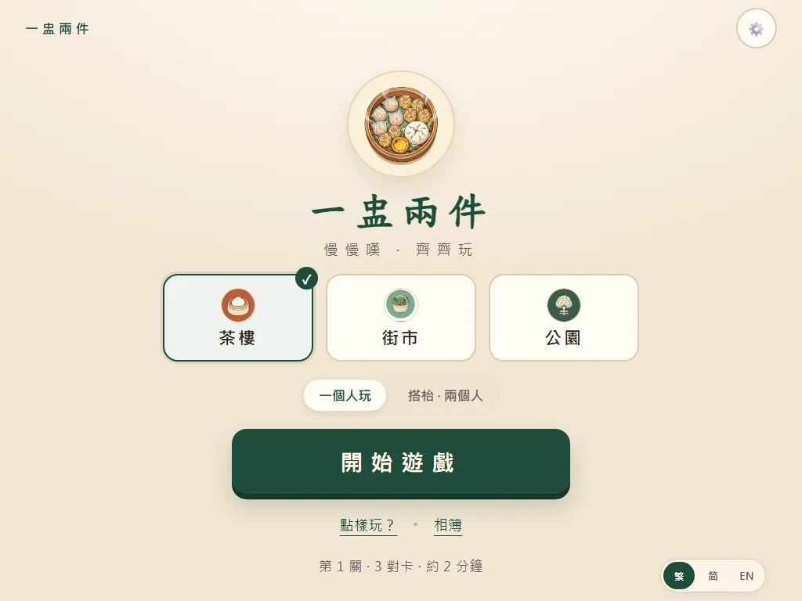
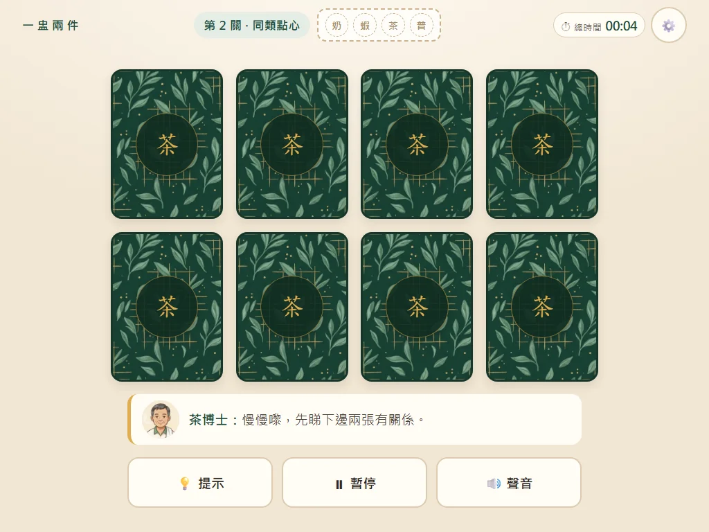
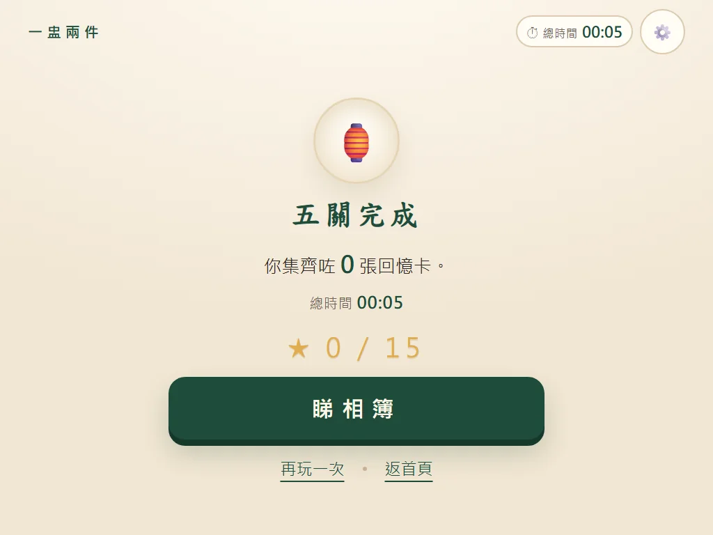
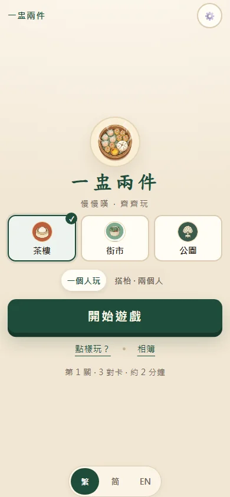
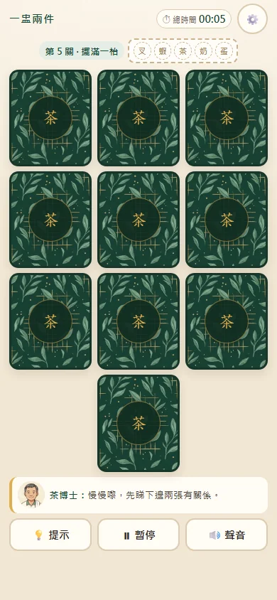
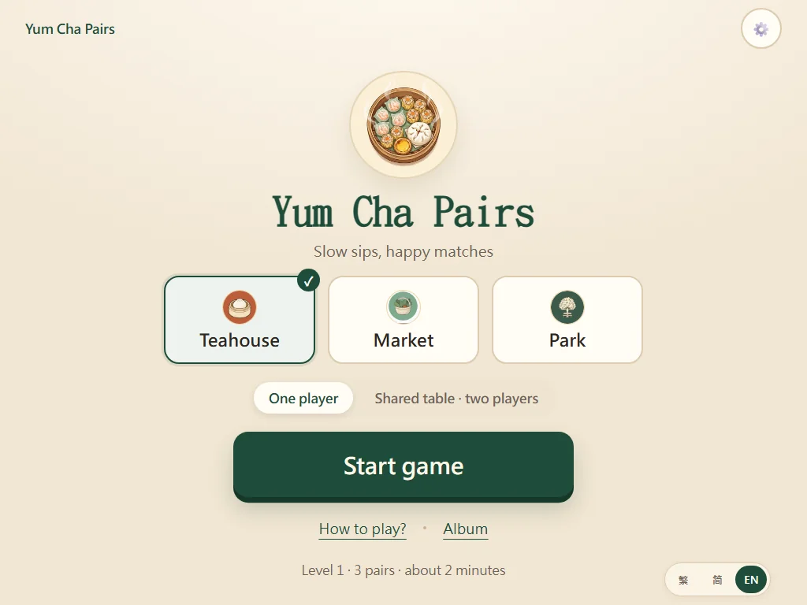

# 一盅兩件 · Yum Cha Pairs

> 為長者而設的廣東茶樓卡牌配對遊戲。  
> 慢慢嘆，齊齊玩。


《一盅兩件》是一款以香港**茶樓、街市、公園**為主題的長者卡牌配對遊戲。翻開兩張卡，找出相同、同類或相襯的一對；每配對成功，點心紙蓋一個印，茶博士送上一次舊時回憶。

沒有倒數、沒有紅色錯誤、沒有「輸」；可以慢慢玩，也可以兩個人搭枱。

<p align="center">
  
  
  
</p>

<p align="center">
  
  
  
</p>

---

## 這是什麼

- **3 個主題**：茶樓、街市、公園
- **每個主題 5 關**：相同 → 同類 → 相襯 → 混合
- **49 組配對、59 張卡牌插畫**
- **粵語回憶**：每對卡都連住一句香港長者的生活片段
- **搭枱雙人**：兩個人輪流翻牌，共用一張點心紙
- **完全離線**：純前端，雙擊 `index.html` 即玩

## 亮點

| 功能 | 說明 |
|---|---|
| 點心紙進度 | 每配對成功蓋一個印，完成一關後變成一張點心紙 |
| 茶博士提示 | 三層提示：方向 → 類別 → 發光位置；連續錯 2 次會自動出手 |
| 回憶相簿 | 收集回憶卡；只顯示文字印章、卡名與回憶，不載入插畫 |
| 正計時總時間 | 右上角 `總時間` 由 0:00 累加；暫停／設定不計；逐主題儲存 |
| 搭枱雙人 | 輪流翻牌、共用進度，適合兩老一齊玩 |
| 三語 | 繁體中文／簡體中文／English，主頁右下角切換 |
| 手機版 | 390／375／360 闊自動切換；短螢幕 5 對卡改 4 欄 |
| 無障礙 | 大字、高對比、減少動態、鍵盤、讀屏、無倒數 |

## 快速開始

不需要 npm、不需要 build、不需要伺服器。

```bash
git clone <your-repo-url>
cd <repo>
```

**Windows**

```powershell
start index.html
```

**macOS**

```bash
open index.html
```

**Linux**

```bash
xdg-open index.html
```

> 如果你下載的是 zip，請先「解壓縮全部」，再開資料夾內的 `index.html`。  
> 不要在壓縮檔預覽視窗內直接開，否則 CSS／JS／圖片會載入不到。

### GitHub Pages

1. 把專案推上 GitHub。
2. Settings → Pages → Deploy from a branch → `main` / `(root)`。
3. 遊戲網址：`https://<username>.github.io/<repo>/`

## 玩法

1. 選主題（茶樓／街市／公園）。
2. 按「開始遊戲」。
3. 入場前可揀字級（標準／大／特大）同高對比。
4. 點兩張卡：
   - 相同 → 第 1 關
   - 同類 → 第 2 關
   - 相襯 → 第 3 關
   - 混合 → 第 4、5 關
5. 配對成功，點心紙蓋印，茶博士讀出一句回憶。
6. 完成 5 關後，完成頁會顯示該主題的**總時間**與總星數。

### 鍵盤

- `Tab` 移動、`Enter`／`Space` 翻牌。
- 彈窗開啟時背景會用 `inert` 鎖住。
- 畫面會有 `aria-live` 播報。

## 主題與卡牌

| 主題 | 卡牌數 | 例子 |
|---|---:|---|
| 茶樓 | 21 | 蝦餃、燒賣、蛋撻、普洱、點心紙、老花鏡 |
| 街市 | 21 | 菜心、鮮魚、豬肉、磅秤、環保袋、雨傘 |
| 公園 | 17 | 太極、雀籠、風箏、象棋、二胡、晨運 |

每個主題 5 關，合共 **15 關**；卡牌插畫合共 **59 張**。

## 長者友善設計

| 原則 | 做法 |
|---|---|
| 大字 | 以 rem 整體放大；可選 100% / 110% / 125%，主要內容 18px 起 |
| 高對比 | 黑白分明模式，以 7:1 對比為目標 |
| 大目標 | 卡牌與主要按鈕 44–88px，不需要拖曳 |
| 無壓力 | 沒有倒數、沒有失敗、沒有紅色錯誤 |
| 提示 | 三層提示，不扣分；連續錯 2 次自動提示 |
| 時間 | 只有正計時總時間，沒有時間限制；可暫停 |
| 動態 | 減少動態模式；支援 `prefers-reduced-motion` |
| 讀屏 | `aria-live`、`aria-pressed`、彈窗 `inert`、清楚標籤 |
| 語言 | 繁中／簡中／英文；卡名、提示、回憶同步切換 |

## 總計時

- 每個主題由第 1 關開始 `0:00`，**正計時**累加。
- 顯示在遊戲右上角；結算頁與完成頁再顯示一次。
- 暫停、設定、結算畫面不計時。
- 每個主題分開儲存；重新開始第 1 關會歸零，「繼續上次」會接住。
- 超過一小時會顯示 `h:mm:ss`。

## 語言

主頁右下角可切換：

- **繁**：繁體中文（香港粵語）
- **简**：簡體中文（由 OpenCC 轉換，保留香港粵語口語）
- **EN**：English

介面、關卡名、卡名、提示、回憶、語音語言都會同步切換。

## 專案結構

```text
.
├── index.html
├── css/
│   └── style.css
├── js/
│   ├── data.js            49 組卡牌、3 個主題
│   ├── art.js             卡名 → WebP 路徑
│   ├── art-available.js   自動產生的插畫清單
│   ├── i18n.js            繁中／英文介面與內容
│   ├── i18n-hans.js       OpenCC 生成的簡體字典
│   └── app.js             狀態機、提示、計時、儲存
├── assets/
│   ├── cards/             59 張卡牌 WebP
│   └── ui/                6 張 UI WebP
├── screenshots/           桌面、手機、三語、計時截圖
├── art/
│   ├── ART-GUIDE.md       插畫風格與規格
│   ├── art-list.csv       65 張插畫清單
│   ├── prompts-*.md       生成 prompt
│   ├── convert_webp.py    圖片轉 WebP
│   └── prepare_images.py  自動裁切
└── TEST-REPORT.md         測試報告
```

## 技術

- 純 HTML / CSS / JavaScript，**沒有框架、沒有 build step**
- 使用 classic script，沒有 ES modules、沒有 `fetch`
- 所有圖片、字體、音效均為本地；遊戲期間不發網絡請求
- 進度與設定存在 `localStorage`（key：`yumcha.v1`）
- 插畫全部 WebP；卡牌與 UI 仍是 1024×1024
- 音效由 Web Audio 即時合成；語音用瀏覽器 `speechSynthesis`

### 瀏覽器

- 建議 Chrome / Edge。
- Safari 15.5+（因 `inert`）應可，未在真實 iPhone 上手測。
- Firefox 支援 WebP，理論上可玩。

## 測試

完整報告：[TEST-REPORT.md](TEST-REPORT.md)

- 3 主題 × 5 關：**15/15 PASS**
- 繁中／英文／簡中：各自 15/15 PASS
- 離線（封鎖 DNS）：15/15 PASS
- 125% 字級＋高對比：桌面與手機通過
- 手機 390×844、375×667、360×740：通過
- 錯誤配對＋提示、完成畫面：通過

### 重跑自動流程

```text
index.html?autotest=1
index.html?autotest=1&lang=en
index.html?autotest=1&lang=zh-Hans
```

### 開發者參數

| 參數 | 用途 |
|---|---|
| `?lang=en` / `?lang=zh-Hans` | 直接以英文／簡中開啟 |
| `?debug=game&level=2` | 直接開始第 2 關 |
| `?debug=result` | 結算畫面 |
| `?debug=album` | 相簿（填入 4 張示範回憶卡） |
| `?debug=settings` / `tutorial` / `quick` / `pause` / `hint` / `final` | 各畫面 |
| `?scale=1.25&hc=1` | 特大字級＋高對比 |
| `?auto=1` | 自動通關 |

## 插畫與 AI

- 59 張卡牌＋6 張 UI 插畫以 AI 圖像生成工具（Gemini）製作，經人手挑選、裁切、轉 WebP。
- 程式、文案、三語翻譯在 AI 協助下完成，經人手整合、測試與修正。
- 插畫風格、prompt 與清單在 [`art/`](art/)。
- 相簿**不載入插畫**，只顯示文字印章與回憶。

## 已知限制

- 語音用瀏覽器 `speechSynthesis`；系統沒有粵語／英文聲時會靜音。
- 總時間是**每個主題 5 關**一個總數，不是三個主題合共一個大總數。
- 手機版只針對直向；橫向會沿用桌面／平板版面。
- 英文翻譯未經母語者校對；簡體版保留香港粵語口語。
- 沒有後端、帳號、雲端同步；所有進度只存在本機 `localStorage`。
- 未附 LICENSE；預設保留所有權利。

## 授權

本專案暫未附 `LICENSE`。如要公開 fork、重用或改作，請先：

1. 補上合適的 LICENSE（例如 MIT 或 CC BY-NC 4.0）；
2. 確認 AI 插畫、字體與其他素材的使用條款；
3. 保留出處與比賽相關聲明。

## Credits

- 遊戲設計、內容整理、測試：vince
- AI 插畫：Gemini
- AI 輔助開發：DeepSeek Harness
- 茶樓、街市、公園卡牌與廣東話回憶：作者整理

---

為香港長者而設 · 2026 · 最後更新 2026-11-19


